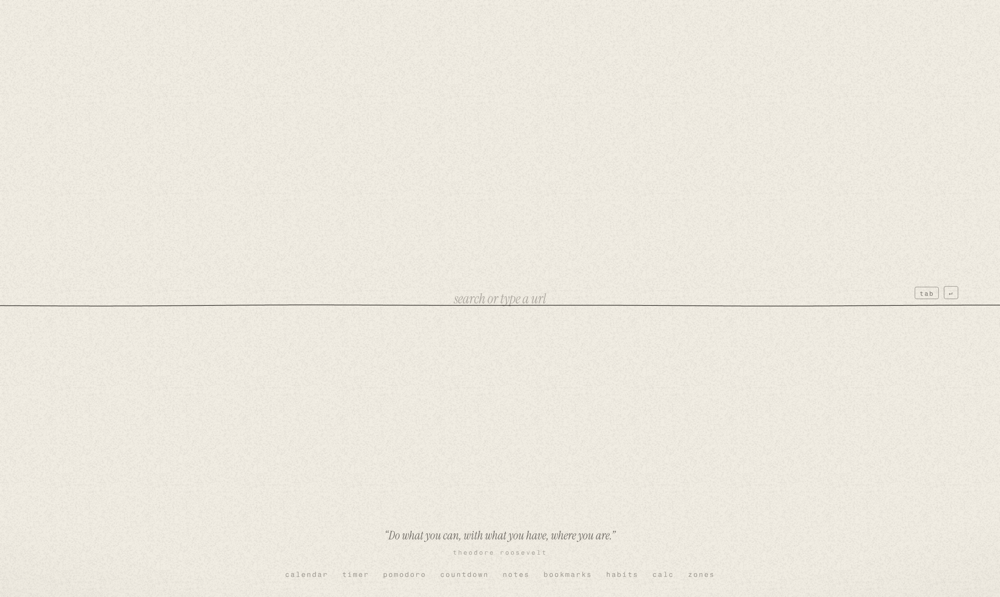
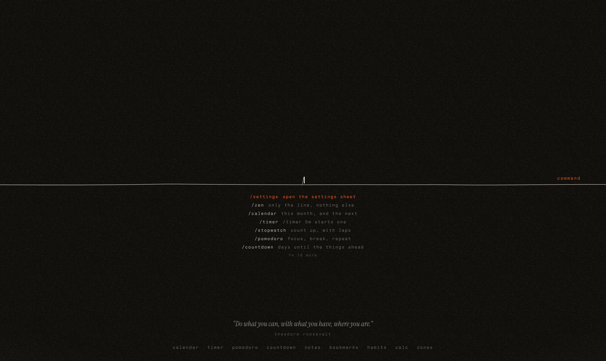
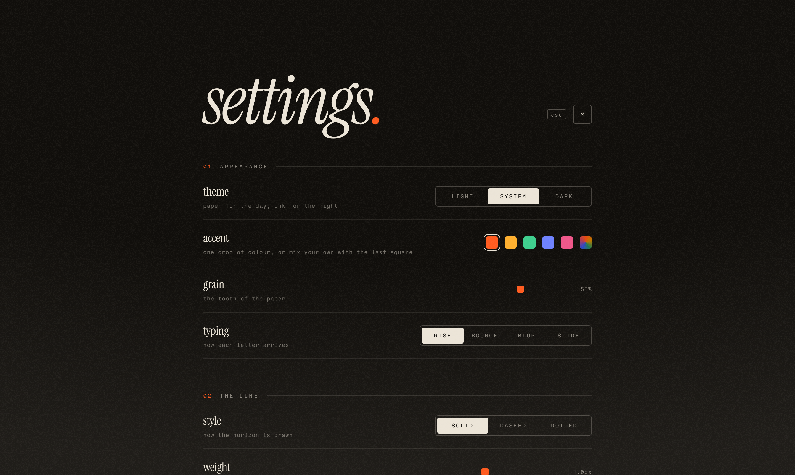
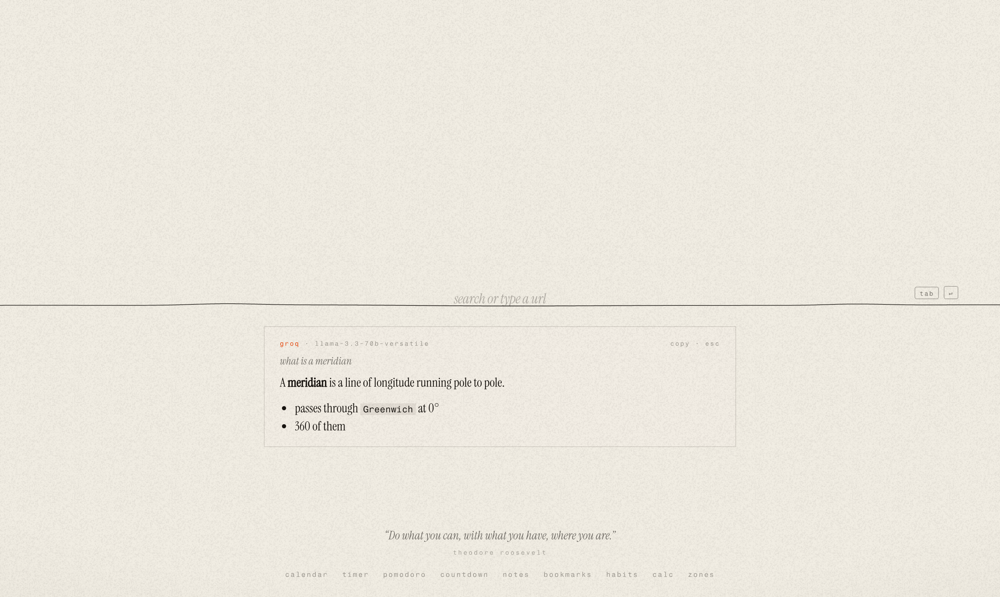
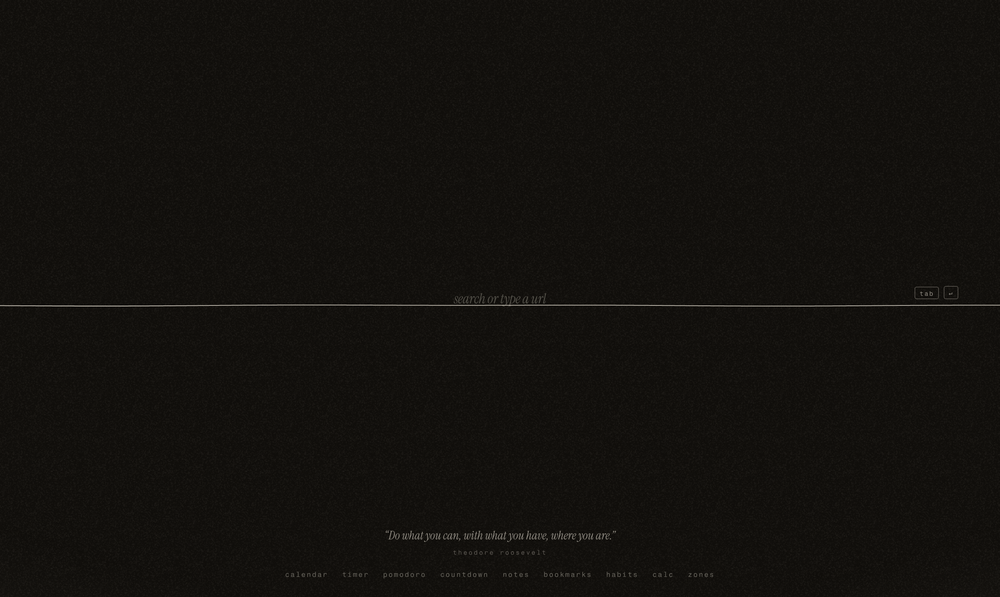

<div align="center">

# meridian<sub><sup>.</sup></sub>

**A calm, typographic start page drawn on a single line.**

Paper for the day, ink for the night. Type on the horizon — search, open, or run a command.

[**Live demo →**](https://meridian.ethembeldagli.dev) &nbsp;·&nbsp; [Set as new tab](#use-it-as-your-new-tab) &nbsp;·&nbsp; [Commands](#commands)


<br>



</div>

---

## Why

Most start pages are dashboards. **meridian** is the opposite: one line across a sheet of grainy paper, and a cursor waiting on it. Everything else — clock, weather, tools, sound — lives one keystroke away — including an AI that answers right on the line — and fades out when you don't need it.

It's a single `index.html`. No framework, no build, no account. Settings stay in your browser.

<table>
<tr>
<td width="50%"></td>
<td width="50%"></td>
</tr>
<tr>
<td align="center"><sub>type <code>/</code> for the command palette</sub></td>
<td align="center"><sub>an editorial settings sheet</sub></td>
</tr>
</table>

## Features

| | |
|---|---|
| **The line** | Search or type a URL right on the horizon. `tab` switches engine (Google, DuckDuckGo, Brave, YouTube, Wikipedia, or your own). Line style, weight and a *light drift* that warms at golden hour and cools at dawn. |
| **Ask AI** | Start the line with `?` and a [Groq](https://groq.com)-powered answer streams in under the horizon. Follow-ups keep the thread; `esc` forgets it. Bring your own free key, pick any model your key can use. |
| **Weather on the line** | Rain, snow and storms literally strike the horizon when it's happening where you are — via Open-Meteo. |
| **Typing that feels physical** | Four letter animations (rise, bounce, blur, slide), optional typewriter key sounds, a live-synthesised ambient loop, and Android haptics. |
| **The dock** | Calendar, timer, stopwatch, pomodoro, countdowns, notes, bookmarks, habits, calculator and time-zone converter. |
| **Around the line** | Clock, date, world clocks, weather with 4-day forecast, quote of the day, frequent sites, recent searches, and a crypto/stock ticker. |
| **Snippets** | Type a trigger + space and it expands. Built in: `;date` `;time` `;now`. |
| **Calm** | Zen mode (everything fades but the line) and a 20-20-20 blink reminder synced across tabs. |
| **Yours** | Light / dark / system, six accents plus a custom colour, adjustable paper grain. Export everything as JSON. |

<div align="center"><br><sub>type <code>? anything</code> — answers stream in from Groq</sub></div>

## Commands

Type `/` on the line.

| Command | Does |
|---|---|
| `? question` · `/ask` | ask Groq AI |
| `/settings` | open the settings sheet |
| `/zen` | only the line, nothing else |
| `/timer 5m` | start a timer |
| `/stopwatch` · `/pomodoro` · `/countdown` | time tools |
| `/calendar` · `/notes` · `/bookmarks` · `/habits` · `/calc` · `/zones` | open a dock panel |
| `/rain` · `/snow` · `/storm` | weather on the line |
| `/blink` · `/quote` | rest your eyes · another quote |
| `/theme light\|dark\|system` | switch theme |
| `/copy settings` · `/clear history` · `/reset everything` | housekeeping |

## Use it as your new tab

**Quickest:** set your browser's homepage / startup page to
`https://meridian.ethembeldagli.dev`

**New-tab override:** most browsers don't allow a custom new-tab URL natively — use an extension such as *New Tab Redirect* (Chrome/Edge) or *New Tab Override* (Firefox) and point it at the URL above.

**Offline / local:**

```bash
git clone https://github.com/ethembeldagli/meridian.git
```

Then open `meridian/index.html` in your browser.

## Under the hood

- **Vanilla HTML, CSS & JS** in one file — canvas for the line, grain and weather; Web Audio for keys and ambience.
- **Type:** Instrument Serif × Fragment Mono.
- **AI:** [Groq](https://console.groq.com) chat completions, streamed straight from the browser. Your API key is stored only in your browser and sent only to Groq — it is never in this repo.
- **Data:** [Open-Meteo](https://open-meteo.com) (weather, geocoding), [CoinGecko](https://www.coingecko.com) (coins), [Finnhub](https://finnhub.io) (stocks, optional key). No analytics, no cookies — everything is stored in `localStorage`.
- Respects `prefers-color-scheme`, keyboard-first, works on mobile.

<div align="center">
<br>

<br><br>
<sub>MIT © ethembeldagli</sub>
</div>
